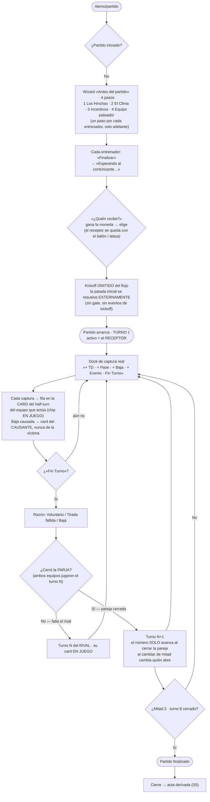

# Flujo del enfrentamiento — mapa de verificación

Diagrama del flujo real de `/demo/partido` (dirección A: captura única en vivo, acta derivada),
contrastado con el código y los tests. Para verificar que lo implementado coincide con lo esperado.

## Reglas de las cards (por half-turn)

| Situación | Resultado |
|---|---|
| Turno activo | Card siempre visible, chip **EN JUEGO**, acciones aparecen al registrarse |
| Half-turn cerrado **sin** registros | La card **no se renderiza** (desaparece) |
| Half-turn cerrado **con** registros | Card permanece: segunda en jugar = COMPLETADO, la que abrió = CERRADO |
| Evento de sistema (neutro) | Card «AMBOS EQUIPOS» |
| Baja causada | Card del **causante** (el DTO lleva el lado de la víctima; el acta la atribuye al causante) |

## Dados (motor `lib/random.ts`, PR #404)

- `rollD16` = **1D16 uniforme** para la tabla de lesiones (tirada real de mesa) · `rollD3` = d6/2 · `roll2D6` = **suma** de dos d6 (triangular) · semilla `createRng(seed)` **solo para tests**.

## Qué verifica cada test de flujo

| Tramo del diagrama | Test |
|---|---|
| Wizard → quién recibe → T1 (sin kickoff) | `actaDemoHarness.test.tsx` · happy path + describe T9 |
| Pair rule T1r → T1o → T2 | `actaDemoHarness.test.tsx` · T10 (test 1) |
| Half-turn vacío → sin card | T10 (test 2) · `actaTurnTimeline.test.tsx` |
| Recarga a mitad (F5) | T10 (test 3) · T13 (mid-wizard del 2.º entrenador) |
| Capturas → cards (causante) | T11 (tests 1-4) |
| Cierre (S5) | solo reducer unit — **pendiente de flow test** |

## Backlog conocido

- Heridas al placar con **«ambos derribados»**: definir cómo se registra (pendiente de S4 Combate).
